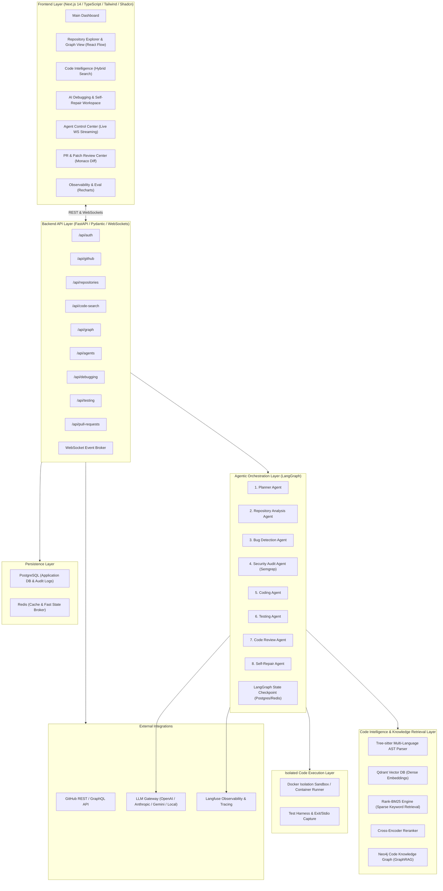

# FORGE: System Architecture & Technical Specifications

## 1. System Vision & Core Philosophy

**FORGE** is an enterprise-grade autonomous AI-powered software engineering platform designed to ingest, comprehend, debug, modify, test, review, and maintain real-world software repositories with rigorous human-in-the-loop oversight.

Unlike standard conversational coding assistants that operate on disconnected text snippets, FORGE operates as a multi-agent system executing an end-to-end cognitive loop:
```
Understand ──> Analyze ──> Plan ──> Code ──> Test ──> Repair ──> Review ──> Deliver
```

### Key Engineering Guarantees
1. **Zero Unverified Hallucinations**: Code references, line numbers, and symbols are anchored in concrete AST (Abstract Syntax Tree) elements and knowledge graph entities.
2. **Deterministic Sandboxing**: Untrusted repository code never runs directly on the host application layer; execution occurs in restricted, resource-capped, unprivileged isolation.
3. **Strict Human-in-the-Loop (HITL)**: All destructive operations (creating branches, applying commits, pushing to remotes, and creating Pull Requests) require explicit developer authorization.
4. **Resilient Self-Repair**: Controlled correction loops operate with bounded retry limits, differential patch analysis, and automatic rollback on regression.

---

## 2. High-Level Architecture



---

## 3. Multi-Agent Orchestration & Agent Contracts

FORGE utilizes a unified **LangGraph** state machine where each agent is an autonomous actor adhering to strongly-typed Pydantic schemas.

### 3.1 The 8 Specialized Agents

| Agent | Responsibility | Key Inputs | Key Outputs | Guardrails |
| :--- | :--- | :--- | :--- | :--- |
| **1. Planner** | Task decomposition, dependency graph creation, subtask delegation. | User prompt, repo metadata, issue context. | `ExecutionPlan` (subtasks, ordering, dependencies). | Enforces DAG dependencies; prevents cyclic execution. |
| **2. Repository Analysis** | Architecture identification, entrypoint scanning, dependency profiling. | Raw repo structure, AST symbols. | `RepositorySummary`, architectural taxonomy. | Read-only; parses configs (`package.json`, `pyproject.toml`, etc.). |
| **3. Bug Detection** | Static anomaly detection, logic flaw tracing, runtime error parsing. | Issue logs, stack traces, retrieved code AST. | `BugReport` (confidence, file, line ranges, explanation). | Discriminates confirmed bugs vs hypotheses; requires evidence. |
| **4. Security Audit** | Vulnerability scanning, secret detection, Semgrep rules integration. | Target source modules, AST chunks. | `SecurityAuditReport` (CWE IDs, severity, remediation). | No claims of 100% coverage; outputs actionable CVE/CWE tags. |
| **5. Coding** | Patch synthesis, context-aware editing, convention matching. | Task spec, target files, AST context, review feedback. | `ProposedPatch` (unified diff, rationale, impacted symbols). | Minimizes diff blast radius; preserves existing styles. |
| **6. Testing** | Test discovery, test suite generation, test execution in sandbox. | Workspace files, generated patch. | `TestExecutionReport` (passed, failed, skipped, logs). | Runs strictly inside isolated container with timeout limits. |
| **7. Code Review** | Independent sanity check, regression detection, style enforcement. | Unified diff, original code, test results. | `ReviewReport` (approved, blockers, suggestions). | Evaluates security, maintainability, performance regressions. |
| **8. Self-Repair** | Error log root cause analysis, patch mutation coordination. | Failed test outputs, prior patch history. | `RepairAction` (feedback for Coder or termination). | Strict max retry budget ($N \le 3$); stops thrashing. |

### 3.2 State Schema (`ForgeWorkflowState`)
```python
from typing import List, Dict, Any, Optional
from pydantic import BaseModel, Field

class ForgeWorkflowState(BaseModel):
    session_id: str
    repository_id: str
    task_id: str
    user_request: str
    error_logs: Optional[str] = None
    
    # Execution Tracking
    current_phase: str
    retry_count: int = 0
    max_retries: int = 3
    
    # Agent Artifacts
    plan: Optional[Dict[str, Any]] = None
    repo_summary: Optional[Dict[str, Any]] = None
    retrieved_contexts: List[Dict[str, Any]] = Field(default_factory=list)
    graph_subgraphs: List[Dict[str, Any]] = Field(default_factory=list)
    bugs_detected: List[Dict[str, Any]] = Field(default_factory=list)
    security_findings: List[Dict[str, Any]] = Field(default_factory=list)
    proposed_patches: List[Dict[str, Any]] = Field(default_factory=list)
    test_results: List[Dict[str, Any]] = Field(default_factory=list)
    review_report: Optional[Dict[str, Any]] = None
    
    # Final Outcome & Approvals
    human_approved: bool = False
    pull_request_url: Optional[str] = None
    status: str = "INITIALIZED"  # IN_PROGRESS, COMPLETED, FAILED, AWAITING_APPROVAL
```

---

## 4. Advanced Code RAG & GraphRAG

### 4.1 Hybrid Retrieval Pipeline
```
Code File ──> Tree-sitter / AST ──> Semantic Chunks (Classes, Functions, Methods)
                                         ├──> Dense Vector (BGE / Text-Embedding-3) ──> Qdrant
                                         └──> Sparse Tokenizer ──> BM25 Index
User Query ──────────────────────────────────> Hybrid Search (Reciprocal Rank Fusion)
                                                     │
                                                     ▼
                                        Cross-Encoder Reranker
                                                     │
                                                     ▼
                                            Top-K Code Chunks
```

### 4.2 GraphRAG Schema (Neo4j)
Entities and Relationships:
- **Entities**: `(:Repository)`, `(:File)`, `(:Module)`, `(:Class)`, `(:Function)`, `(:Method)`, `(:Import)`
- **Edges**:
  - `(Repository)-[:CONTAINS]->(File)`
  - `(File)-[:DEFINES]->(Class|Function)`
  - `(Class)-[:HAS_METHOD]->(Method)`
  - `(Function)-[:CALLS]->(Function)`
  - `(File)-[:IMPORTS]->(Module)`
  - `(Class)-[:INHERITS]->(Class)`
  - `(Module)-[:DEPENDS_ON]->(Module)`

Querying combines vector relevance with 2-hop graph neighborhood expansion to ensure calling contexts and callers are retrieved together.

---

## 5. Isolated Code Execution Architecture

To guarantee host safety, code execution is separated via a Container Runner abstraction:
- **Sandbox Strategy**:
  - Docker container created on-demand with non-root user (`uid=1000`).
  - Network isolation (`--network none`) for test runs.
  - Read-only root filesystem with ephemeral `/tmp` and workspace mounts (`tmpfs`).
  - Strict resource limits: max 1.5 CPUs, 2GB RAM, execution timeout of 60 seconds.
  - Execution captures `stdout`, `stderr`, and exit code in real time.
- **Local Fallback Mode**: When Docker is not available in development, a secured subprocess runner operates with constrained working directories and timeout guards, explicitly flagging demo/fallback execution mode.

---

## 6. GitHub Integration & Human Approval Protocol

FORGE enforces the **Human-in-the-Loop Gate**:
```
Analysis (Read-Only) ──> Propose Patch ──> Test Execution ──> Code Review
                                                                    │
                                                          [HUMAN APPROVAL GATE]
                                                                    │
                                        ┌───────────────────────────┴───────────────────────────┐
                                        ▼                                                       ▼
                                     Approved                                                Rejected
                                        │                                                       │
                           Create Branch & Commit PR                                    Abort / Re-plan
```
- OAuth scopes requested: `repo:status`, `public_repo` (or minimal `repo` for private).
- Tokens stored securely with AES-GCM encryption at rest; never transmitted to frontend clients.

---

## 7. Relational Database Schema (PostgreSQL)

Key tables and relationships:
1. `users` (id, email, hashed_password, created_at)
2. `github_accounts` (id, user_id, github_user_id, username, access_token_enc, avatar_url)
3. `repositories` (id, user_id, github_repo_id, full_name, clone_url, default_branch, is_private, indexed_at)
4. `indexing_jobs` (id, repository_id, status, total_files, indexed_files, error_message, created_at, completed_at)
5. `code_artifacts` (id, repository_id, file_path, language, entity_type, entity_name, start_line, end_line, content_hash)
6. `debugging_sessions` (id, repository_id, user_id, title, description, status, current_phase, created_at)
7. `agent_executions` (id, session_id, agent_name, input_state, output_state, duration_ms, status, error, created_at)
8. `patches` (id, session_id, iteration, diff_content, affected_files, rationale, is_applied, created_at)
9. `test_executions` (id, session_id, patch_id, exit_code, stdout, stderr, passed_count, failed_count, created_at)
10. `security_findings` (id, repository_id, session_id, rule_id, severity, file_path, line_number, message, recommendation)
11. `pull_requests` (id, session_id, repository_id, branch_name, pr_number, pr_url, title, status, created_at)
12. `audit_logs` (id, user_id, action, target_type, target_id, metadata_json, ip_address, timestamp)

---

## 8. Frontend UI/UX Design System

- **Palette**: Deep Navy (`#0A0E17`), Slate Card (`#111827`), Violet Accent (`#8B5CF6`), Cyan Accent (`#06B6D4`), Emerald Success (`#10B981`), Rose Danger (`#F43F5E`).
- **Typography**: Inter (Body), JetBrains Mono (Code & Logs).
- **Core Views**:
  1. Main Dashboard (KPI cards, active sessions, quick action bar).
  2. Repository Explorer (Tree viewer, Monaco editor preview).
  3. Code Intelligence (Natural language search, semantic references with exact file/line links).
  4. Agent Control Center (Live React Flow node state visualization + event stream).
  5. AI Debugging Workspace (Input problem, stack trace, automated repair tracker, interactive diff).
  6. Security & Testing Centers (Vulnerability matrix, pytest real-time output).
  7. Pull Request Center (Git tree, patch approvals, one-click PR dispatch).
  8. Monitoring & Observability (Token usage, latency distributions, self-repair convergence).
